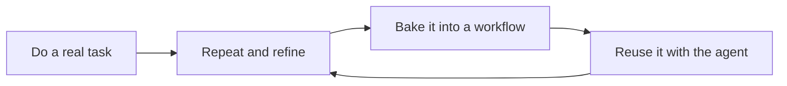

<div align="center">

# Agentic Workflows

**Workflows I built with my agent, refined through repetition, and baked into reusable skills.**

[](LICENSE)
[](docs/harnesses.md)
[](#install)

[Explore the workflows](#cool-things-you-can-do) · [Install](#install) · [Onboarding](plugins/agentic-workflows/skills/agentic-workflows/references/onboarding.md) · [Contribute](#development)

</div>

## The story

I work with my agent on software, research, business operations, creative projects, and everyday tasks. After doing the same kind of work several times, a useful process starts to emerge: how to begin, which tools to use, what to check, and where I need to make a decision.

This repository is where I bake those processes into reusable workflows. The next time a similar task comes up, the agent has a starting point that carries the lessons from earlier sessions.

Each workflow captures more than the opening prompt. It can include instructions, references, templates, helper scripts, and checks for the finished result. The collection keeps growing as I use it and find better ways to work.



## Cool things you can do

| Start with a task | What the workflow brings | Explore |
| --- | --- | --- |
| **Ship a software change** | Grill Me, planning, design, and interactive plan approval before implementation, followed by local checks, a draft PR with up to two review and remediation passes, and a self-contained change summary in chat. Review maps coverage and challenges security candidates against existing controls, keeping unresolved leads distinct from supported findings. Codex delivery orchestration has its own review policy and can coordinate a declared deployment target when explicitly invoked. | [Development workflow](plugins/agentic-workflows/skills/standard-development-workflow/SKILL.md) · [Grill Me](plugins/agentic-workflows/skills/grill-me/SKILL.md) · [Interactive Plan](plugins/agentic-workflows/skills/interactive-plan/SKILL.md) · [Ponytail](plugins/agentic-workflows/skills/ponytail/SKILL.md) · [Engineering Review](plugins/agentic-workflows/skills/engineering-review/SKILL.md) · [Orchestration](plugins/agentic-workflows/skills/orchestration/SKILL.md) |
| **Turn past sessions into better workflows** | Review recurring corrections and rework, identify useful improvements, and check live issues and PRs before proposing duplicate work. | [Session reflection](plugins/agentic-workflows/skills/session-reflection/SKILL.md) |
| **Design a purposeful frontend** | Start with minimal views, reveal detail through interaction, and tailor student, instructor, and manager apps to their tasks. Keep accepted taste in project context. | [UI Design](plugins/agentic-workflows/skills/ui-design/SKILL.md) |
| **Experience your product as a user** | Open the app in a browser, explore journeys and states down to tiny details, and report every distinct improvement in clear user language, prioritized by impact. | [Product Playtest](plugins/agentic-workflows/skills/product-playtest/SKILL.md) |
| **Connect REA to your coding agent** | Run upstream setup, review its plan for approval, and verify the installation. | [REA](plugins/agentic-workflows/skills/rea-setup/SKILL.md) |
| **Build a Chrome extension** | Manifest V3 architecture, modern web APIs and AI fallbacks, optional Chrome DevTools testing, and permission/privacy records for store preparation. | [Chrome Extensions](plugins/agentic-workflows/skills/chrome-extensions/SKILL.md) |
| **Research with papers you can actually inspect** | Find and verify scholarly sources, keep local PDF evidence and research notes, build synthesis matrices, or manage a systematic review's records and reporting. | [Verified research](plugins/agentic-workflows/skills/verified-literature-research/SKILL.md) · [Systematic reviews](plugins/agentic-workflows/skills/systematic-literature-review-workflow/SKILL.md) |
| **Research investments and trading strategies** | Build a dated investment memo with analyst perspectives, opposing cases and portfolio risk review; turn stock/futures hypotheses into costed experiments with existing tools. | [Finance and Trading Research](plugins/agentic-workflows/skills/trading-strategy-research/SKILL.md) · [Investment method](plugins/agentic-workflows/skills/trading-strategy-research/references/investment-research.md) · [Source assessment](plugins/agentic-workflows/skills/trading-strategy-research/references/upstream.md) |
| **Audit search discovery with evidence** | Inspect site/page SEO, indexing, structured data, local/commerce/international templates and AI search visibility; prioritize fixes with source evidence, dependencies and recheck plans. | [SEO Audit](plugins/agentic-workflows/skills/seo-audit/SKILL.md) · [Upstream assessment](plugins/agentic-workflows/skills/seo-audit/references/upstream.md) |
| **Grow a product through useful content** | Develop UGC/customer and creator briefs; choose audience, sources, channel and format; produce video, visual or written assets and review business outcomes. | [Product Growth](plugins/agentic-workflows/skills/product-growth/SKILL.md) · [UGC production](plugins/agentic-workflows/skills/product-growth/references/ugc-production.md) · [Cycle template](plugins/agentic-workflows/skills/product-growth/templates/growth-cycle.md) |
| **Write with an agent beside you** | Plan an academic report, improve prose while preserving meaning, or work paragraph by paragraph with a coach that compiles your own wording. | [Academic writing](plugins/agentic-workflows/skills/academic-writing-workflow/SKILL.md) · [Humanizer](plugins/agentic-workflows/skills/humanizer/SKILL.md) · [Guided writing](plugins/agentic-workflows/skills/guided-writing-coach/SKILL.md) |
| **Run business and cloud operations** | Route ERPNext work across finance, sales, stock, manufacturing, people, and reporting; inspect and operate authorized Supabase, Railway, Cloudflare, and DigitalOcean accounts. | [ERPNext](plugins/agentic-workflows/skills/erpnext-accounting-finance/SKILL.md) · [Supabase CLI](plugins/agentic-workflows/skills/supabase-cli/SKILL.md) · [Railway](plugins/agentic-workflows/skills/railway-account-operations/SKILL.md) · [Vercel](plugins/agentic-workflows/skills/vercel-account-operations/SKILL.md) · [Cloudflare](plugins/agentic-workflows/skills/cloudflare-account-operations/SKILL.md) · [DigitalOcean](plugins/agentic-workflows/skills/digitalocean-account-operations/SKILL.md) |
| **Take a trend through to a product concept** | Keep source-backed audience and trend evidence, test merchandise hypotheses, prepare design briefs, and build launch and measurement packets. | [Trend to Product](plugins/agentic-workflows/skills/trend-product-onboarding/SKILL.md) |
| **Edit a film from assets** | Storyboarding, reference analysis, searchable assets, speech, sound, typography, blending, transitions and keyframes. Use an existing Editonny installation for local speech cleanup and captions, with optional audio-only OpenRouter transcription. | [Video Editing](plugins/agentic-workflows/skills/video-editing/SKILL.md) · [Editonny handoff](plugins/agentic-workflows/skills/video-editing/references/editonny.md) |
| **Make visual assets with checks built in** | Compose original music in code, create editable motion graphics and product showcase videos, preview Excalidraw scenes, generate verified QR codes, or refine food photos. | [Music Composition](plugins/agentic-workflows/skills/music-composition/SKILL.md) · [Motion Design](plugins/agentic-workflows/skills/motion-design/SKILL.md) · [Excalidraw](plugins/agentic-workflows/skills/excalidraw-scene-operations/SKILL.md) · [QR codes](plugins/agentic-workflows/skills/qr-code-generation/SKILL.md) · [Food images](plugins/agentic-workflows/skills/food-image-editing/SKILL.md) |
| **Build a media library you can resume** | Inspect metadata and retrieve authorized media and subtitles across yt-dlp-supported platforms, and incrementally sync bounded playlists and channels. Browse Reddit through a connected browser session. | [yt-dlp media](plugins/agentic-workflows/skills/youtube-content-inspection/SKILL.md) · [Reddit](plugins/agentic-workflows/skills/reddit-browsing/SKILL.md) |
| **Sync bank activity into your budget** | Match Commonwealth Bank activity to Actual, keep descriptive Notes and existing categories, and reconcile, clear and lock transactions. Requires both apps logged in in Codex’s built-in browser. | [Budgeting](plugins/agentic-workflows/skills/budgeting-account-sync/SKILL.md) |
| **Bring the agent into everyday work** | Plan restaurant campaigns with offer economics and expiry, or estimate meal nutrition with uncertainty. | [Restaurant marketing](plugins/agentic-workflows/skills/restaurant-marketing-management/SKILL.md) · [Calorie tracker](plugins/agentic-workflows/skills/calorie-tracker/SKILL.md) |

Standard Development Workflow runs in Codex.
Codex also includes SDLC autopilot, orchestration, and other host-specific skills.

## What makes these workflows useful

- **They remember the process.** Prerequisites, decision points, recovery steps, and finish criteria live alongside the skill.
- **They check the result.** Depending on the task, that means tests, source evidence, a decoded QR payload, a rendered scene, or a provider readback.
- **They keep decisions explicit.** Drafting, publishing, merging, deploying, and spending have distinct boundaries in the workflows that need them.
- **They improve through use.** Session reflection helps turn recurring friction into a concrete workflow improvement.
- **They work in Codex.** One catalog supplies the complete suite, native tools, and connected-app handoffs.

Supabase, Railway, Cloudflare, DigitalOcean, ERPNext, and Excalidraw default to
authenticated CLI/client operations. If CLI authentication is missing, use the
built-in Codex browser for supported login or secure API-key/token acquisition,
then verify CLI identity and the exact project target. Browser service operations
are fallback only when the authenticated client cannot perform the requested action.

Supabase, Railway, Cloudflare, and DigitalOcean CLI credentials are stored in a project-local, gitignored `.cli/` directory. New worktrees carry over local environment files and `.cli/` credentials, then verify authentication and the exact target again. See the [credential contract](plugins/agentic-workflows/skills/agentic-workflows/references/task-authority-and-secrets.md#project-local-cli-credentials).

A skill supplies the working method. Your host supplies the model and tools, and provider workflows use your own configured accounts. Read the selected skill's **Prerequisites** before starting; some workflows depend on Codex-specific capabilities.

Vercel always uses the [Vercel plugin/connected app through Codex](plugins/agentic-workflows/skills/vercel-account-operations/SKILL.md), including connection setup and account operations. It needs no local CLI credential store.

## Install

Install `agentic-workflows` once for all 69 Codex skills. The marketplace publishes one Codex plugin; provider tools and connections are needed only when their workflow is used.
Every skill points to a [suite capability map](plugins/agentic-workflows/CAPABILITIES.md) with companion workflows, prerequisites, availability, and handoff guidance. The existing catalog generator keeps the Codex capability map aligned with the maintained suite.

### Codex

```sh
codex plugin marketplace add wilsonle/agentic-workflows
codex plugin add agentic-workflows@agentic-workflows
```

Start a new task or session after installation. Ordinary features load as skills. Review and trust the central Codex package's automatic-title hook only if you use that explicit exception; there is no workflow-routing hook. See the [onboarding guide](plugins/agentic-workflows/skills/agentic-workflows/references/onboarding.md) for first-use checks and the [harness guide](docs/harnesses.md) for exact support boundaries.

## Try a real task

Describe the outcome you want. The central router helps select the workflow, and the selected skill checks which tools and setup the task needs.

> Start another session to audit this project; stay here and manage it.

The [Delegation skill](plugins/agentic-workflows/skills/delegation/SKILL.md)
uses Codex's saved configuration by default, honors explicit overrides,
and verifies effective settings before dependent work. New independent Git sessions
default to a new isolated worktree unless you explicitly select another directory
or existing task lane. Delegation requires no launch hook
or global instruction. Installation does not activate a configuration preset.

> Diagnose this bug, implement the fix in an isolated worktree, run the repository checks, and open a PR.

> Help me research this topic. Verify the papers, keep source notes, and build a synthesis matrix before drafting.

> Make a styled QR code for this exact URL and verify that the finished image decodes to the same URL.

> Help me market a new dish. Check the offer economics and campaign readiness before writing content.

You can also name a skill directly. Codex's `$sdlc-loop` is an explicit delivery-orchestration entry point; read its [workflow and authority boundaries](plugins/agentic-workflows/skills/sdlc-loop/SKILL.md) before invoking it.

## Packages

The maintained `agentic-workflows` suite contains 69 Codex skills. Browse the
[capability map](plugins/agentic-workflows/CAPABILITIES.md) for the full inventory
and links to each workflow. Codex is the only supported host.

## Update

### Codex

For an update that also approves this suite's enabled hooks, resolve the installed
`agentic-workflows-config-transfer` skill root and run:

```sh
uv run <skill-root>/scripts/codex_config.py update
```

It backs up config and refreshes only this suite's hook hashes. See
[suite updates and hook trust](plugins/agentic-workflows/skills/agentic-workflows-config-transfer/references/codex-configuration.md#suite-updates-and-hook-trust)
for first-update setup and restoration. Codex UI updates and the native commands
below still need separate hook review or the helper's `trust-hooks` command:

```sh
codex plugin marketplace upgrade agentic-workflows
codex plugin list --marketplace agentic-workflows
```

Start a fresh Codex task after updating and verify the selected workflow. Follow
the [onboarding guide](plugins/agentic-workflows/skills/agentic-workflows/references/onboarding.md)
if an old installation still appears.

## Updates and migration

If you previously installed focused plugins, install or update `agentic-workflows` first and confirm the workflows you use in a fresh session. Then remove those older focused installations through the host's plugin manager. A marketplace refresh changes the available listings; it does not guarantee removal of previously installed plugins, which may otherwise expose duplicate skills. Keep provider credentials and local workflow data when removing an old installation.

The [legacy-components-v1 tag](https://github.com/WilsonLe/agentic-workflows/tree/legacy-components-v1)
preserves the standalone packages and the pre-cutover portable install paths
for consumers that pin a repository path. Use the suite for maintained updates.

If you installed the former AMSoft-named packages, remove the old installations, add this public marketplace, and install `agentic-workflows`. Update old skill invocations in your automations and back up local configuration before migration.

WordPress-related workflows are retired. Uninstall those packages and preserve site-specific runbooks before updating. Follow the [operator migration guide](docs/retired-site-workflows.md) for existing installations and deployed site runtimes.

## Development

The [skills-first audit](docs/skills-first-audit.md) accounts for every distributed
skill, executable helper and install-time entrypoint in this refactor. Ordinary
features belong in skills; retain custom code only for a documented task-specific
need. The automatic-title hook is the explicit approved exception.

The source of truth is [`catalog/plugins-v2.yaml`](catalog/plugins-v2.yaml) and the canonical [suite package](plugins/agentic-workflows). The Codex marketplace is tracked on `main`. The `dist` branch carries a verified copy of the Codex package and marketplace.

Edit the suite package directly. The catalog generator refreshes its capability
map, skill metadata, and Codex marketplace and builds the Codex distribution.

Projects retain durable choices in versioned ADRs. The workflow reads relevant
records before design and reconciles them in each affected PR; existing conventions
take precedence. See the [project ADR maintenance guide](plugins/agentic-workflows/skills/standard-development-workflow/references/project-adrs.md)
for setup, lifecycle and helper commands, and [this project's decision index](docs/adr/README.md).

During development and before opening or updating a PR, run focused tests for the affected
behavior, targeted lint, and generated-package parity. Report those results and defer full-suite
coverage explicitly. Merge approval covers the branch through in-scope fixes, while check and
review evidence must match the current candidate.

Only when merging is requested, run the complete local CI suite. It requires `uv` and ImageMagick 7:

```sh
uv run python scripts/run_local_ci.py
```

This runs repository validation, all unit tests, Ruff, and staged Codex package checks. The full GitHub Actions validation is available by manual dispatch. The [Codex publish workflow](docs/harnesses.md#development-checks) builds and checks packages on pushes to `main`.

For individual development steps:

```sh
uv sync
uv run python scripts/generate_plugin_packages.py --write
uv run python scripts/validate_plugin_packages.py
uv run python -m unittest tests.test_workflow_efficiencies -q
uv run python scripts/generate_plugin_packages.py --check
```

When proposing a workflow, describe the repeated task, the process you refined, and how someone can check the outcome. Keep credentials and private task data outside the repository. The [task authority and concealed secrets contract](plugins/agentic-workflows/skills/agentic-workflows/references/task-authority-and-secrets.md) documents supported credential handling; the [delivery continuity guide](plugins/agentic-workflows/skills/standard-development-workflow/references/efficient-delivery-and-external-work.md) explains verification and handoff records.

For browser-based work in Codex, including verification and credential setup,
prefer the Codex in-app browser. The [browser selection guide](plugins/agentic-workflows/skills/agentic-workflows/references/browser-selection.md)
describes explicit browser choices, capability fallbacks, and evidence requirements.

## Credits and license

Created and maintained by [Wilson Le](https://github.com/wilsonle). The engineering skills adapt ideas from [Matt Pocock's agent skills](https://github.com/mattpocock/skills) and [DietrichGebert's Ponytail](https://github.com/DietrichGebert/ponytail) to this collection's development workflow and approval rules. Pinned provenance and license notices accompany the adapted skills.

Finance and Trading Research retains the `trading-strategy-research` invocation and selectively adapts [TradingAgents](https://github.com/TauricResearch/TradingAgents), [ML4T Skills](https://github.com/ml4t/skills) and [TradeMonty's trading skills](https://github.com/tradermonty/claude-trading-skills). Selected analyst perspectives feed opposing cases, a research proposal, risk review and a dated [investment memo](plugins/agentic-workflows/skills/trading-strategy-research/templates/investment-memo.md); empirical strategy claims continue through the existing experiment lifecycle. Its [source assessment and licenses](plugins/agentic-workflows/skills/trading-strategy-research/references/upstream.md) record adopted methods and limits, including the distinction between recommendation diagnostics and portfolio simulation. Roles work in the current task unless separate agents are authorized. It adds no market-data subscription, backtest engine or brokerage connection.

SEO Audit selectively adapts [AgriciDaniel's Claude SEO](https://github.com/AgriciDaniel/claude-seo). Its [pinned source assessment and MIT notice](plugins/agentic-workflows/skills/seo-audit/references/upstream.md) describe the portable audit methods and modifications. It adds no crawler, provider client, mandatory agent delegation or paid SEO dependency.

[MIT licensed](LICENSE) · Copyright (c) 2026 Wilson Le. Bundled third-party material retains its own attribution and license notices.
